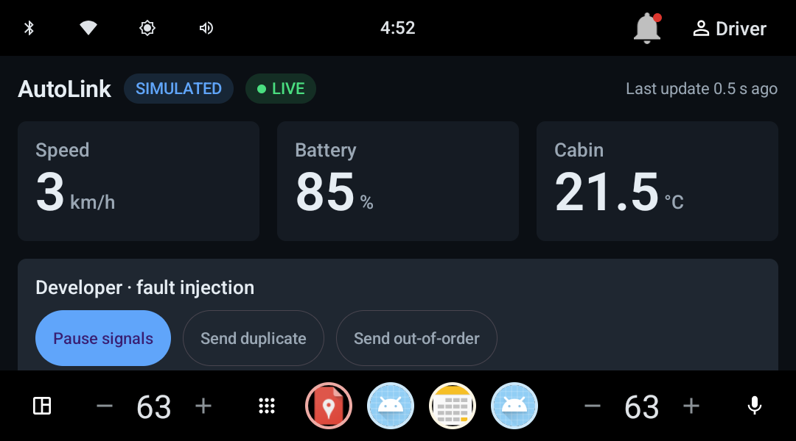
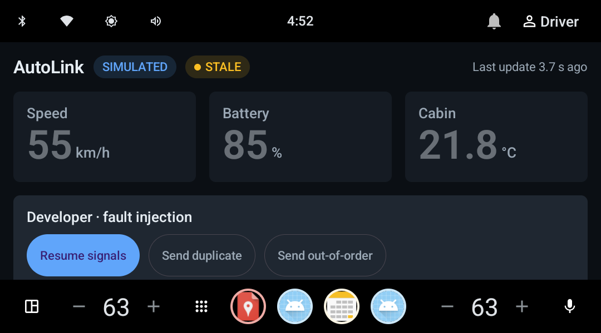
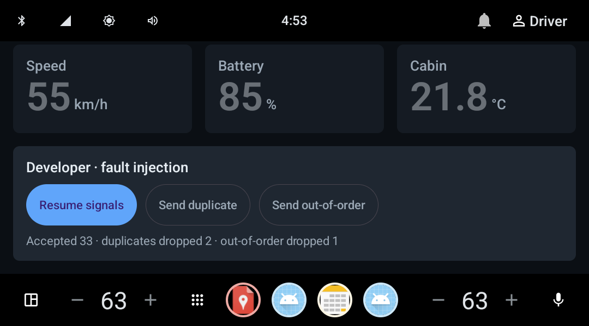
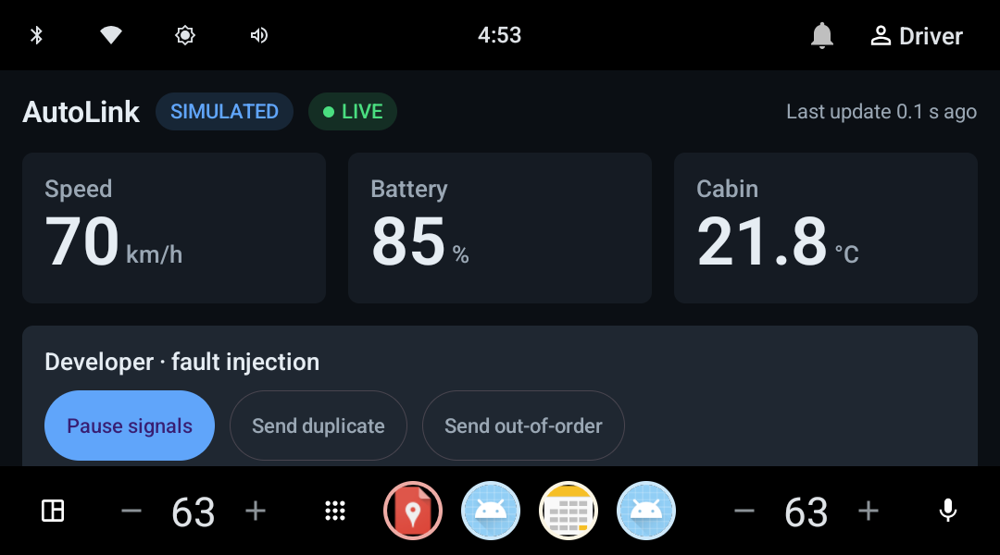
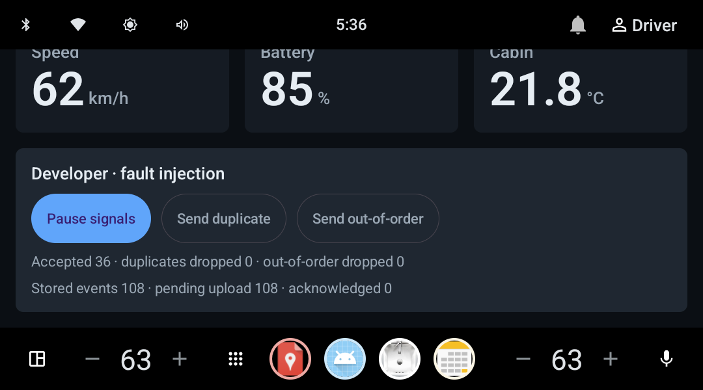
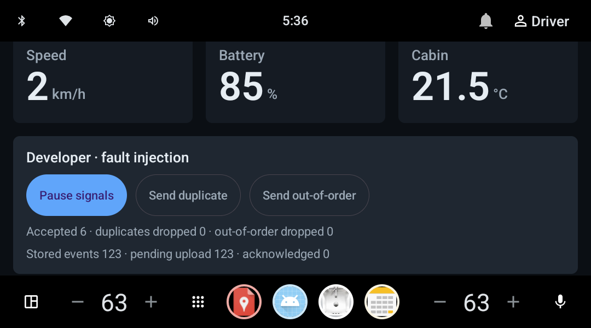

# AutoLink — Android Automotive connected-vehicle POC

A learning/portfolio project: a dashboard of **simulated** vehicle telemetry for Android Automotive OS (AAOS),
built to demonstrate signal freshness, event ordering and clean architecture.

> **Portfolio integrity:** every value on screen is **SIMULATED**. This is not a certified automotive or
> safety-critical system and does not read from or control a real vehicle.

| Live | Paused → stale | Dropped readings | Resumed |
|---|---|---|---|
|  |  |  |  |

## What works (milestones 0–3)

- Simulated vehicle emitting speed, battery and cabin temperature every 500 ms.
- Freshness: **LIVE** → **STALE** when no sample arrives for 2 s (monotonic clock), **UNAVAILABLE** before the first.
- Unknown values render as `--`, never `0`.
- Ordering: duplicate and out-of-order samples are dropped by sequence number and counted on screen.
- Developer panel: pause/resume signals, send a duplicate, send an out-of-order sample.
- **Durable telemetry queue (Room KMP):** every accepted sample becomes one event per signal with a UUID
  generated once, stored as `PENDING` before any upload. Duplicate ids are ignored, and history survives
  process death (see below).

| Before force-stop | After relaunch |
|---|---|
|  |  |

The in-memory "Accepted" counter restarts with the process; "Stored events" continues from the database (108 → 123).

### Retention / eviction policy

Bounded so a week-long outage cannot fill the disk (`RetentionPolicy`, enforced in one transaction per insert):

1. Acknowledged events older than 24 h are deleted (they are only local history).
2. Above 10,000 rows, the oldest rows are deleted, **acknowledged first, then pending**. This is the only
   way pending data is lost; during a long outage the newest 10,000 events are kept.

## Architecture

Clean Architecture + MVVM/UDF, multi-module, Koin DI, Gradle convention plugins in `build-logic`.

```
androidApp ──► shared (Koin root, App())
                 ├─► feature:vehicle   domain/ data/ presentation/ packages
                 │     └─► core:domain  core:common  core:ui  core:designsystem
                 └─► core:data (RoomTelemetryQueue) ─► core:database (Room KMP, bundled SQLite)
```

- `VehicleRepository` returns domain objects only; no UI code sees VHAL property IDs.
- `ReconcilingVehicleRepository` wraps any `VehicleSignalSource` (simulator today, Car API adapter later).
- `TelemetryQueue` (domain) is implemented by `RoomTelemetryQueue` (data); the DB schema is exported to `core/database/schemas`.
- Modules are Kotlin Multiplatform with Android + JVM targets; JVM exists only for fast tests. No iOS (AAOS-only).

## Build and run

Tested with: macOS (Apple Silicon), Android Studio JBR 25, Gradle 9.9.1, AGP 9.5.1, Kotlin 2.4.21,
compileSdk 37 / targetSdk 36 / minSdk 29, Room 2.8.5, KSP 2.3.14, emulator image
`system-images;android-35-ext15;android-automotive;arm64-v8a` (API 35, AAOS).

```bash
./gradlew desktopTest                # 22 unit tests (virtual time + in-memory SQLite, no emulator needed)
./gradlew :androidApp:assembleDebug
emulator -avd AutoLink_AAOS_API35 -gpu host
adb install -r androidApp/build/outputs/apk/debug/androidApp-debug.apk
```

The AAOS emulator has a second (instrument cluster) display; pass `-d <display-id>` to `screencap`.

## Limitations / next

Not yet built: Ktor backend + WorkManager sync (M4), Car API adapter (M5), CI (M6).
Telemetry is recorded only while the dashboard is observed; a foreground service will own collection in M4.
Freshness is snapshot-level, not per-signal. The app is not distraction-optimised (parked-use developer tool).
